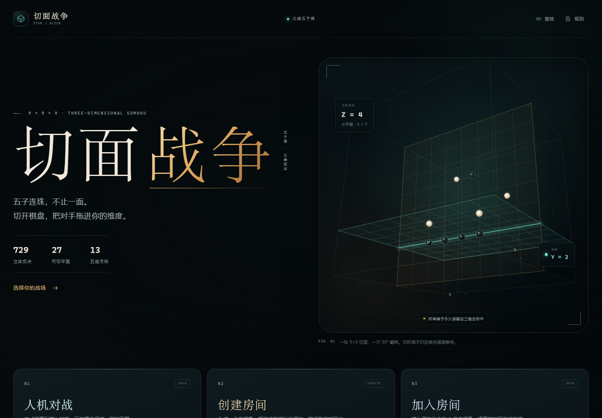
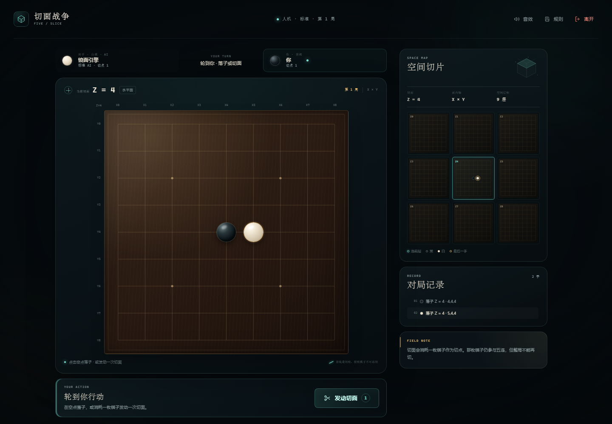
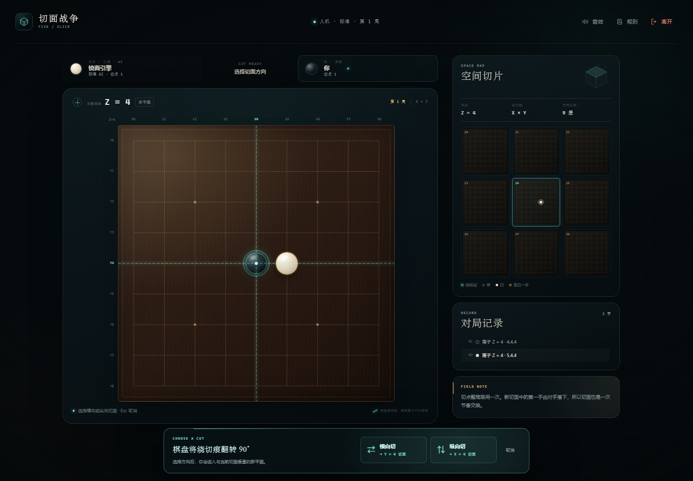
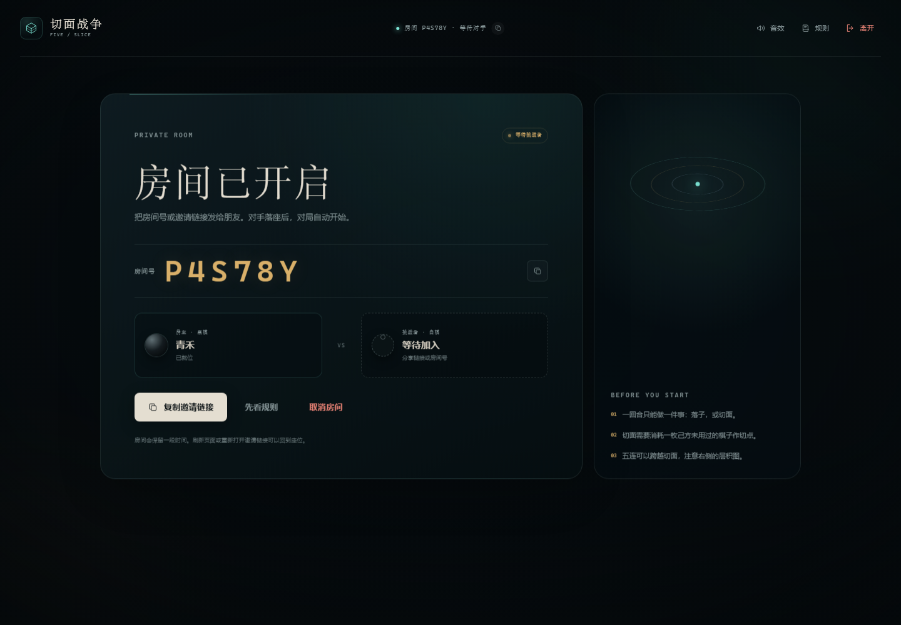
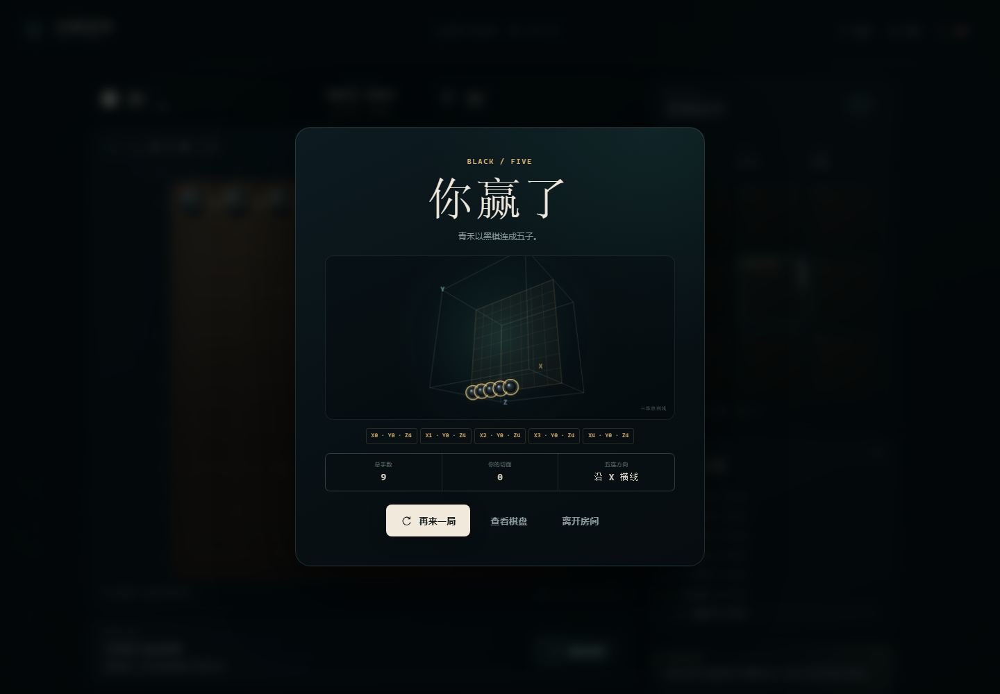
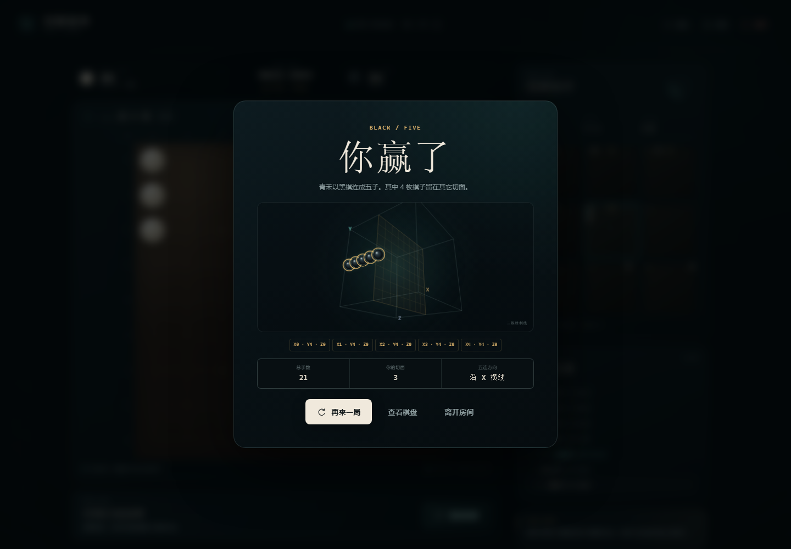
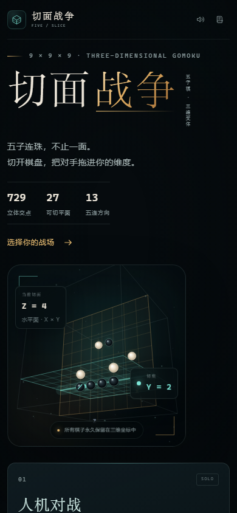

# 切面战争 · FIVE / SLICE

**五子棋，不止一面。** 在 9×9×9 的三维空间里连成五子；切开棋盘，翻转进入另一张切面。

一款零依赖的网页游戏：2D 俯视棋盘 + 空间层积图 + 三档 AI + 房间码联机。



## 快速开始

需要 **Node.js 20+**。项目没有第三方运行时依赖，不需要 `npm install`。

```bash
cd five-slice
npm start
```

终端会打印访问地址（默认端口 **4175**）：

```text
本机   http://localhost:4175
局域网 http://192.168.x.x:4175
```

打开地址即可。可以：

- 直接开始 **人机对战**（无需联网，三档难度）；
- **创建房间**，把 6 位房间号或邀请链接发给朋友；
- 打开邀请链接，输入昵称后 **加入房间**。

Windows 也可以双击 `start.bat` 启动；macOS / Linux 可以用 `bash start.sh`。

> 联机模式必须通过 `npm start` 访问。直接双击 `index.html` 只能看到静态页面，ES Module 与 SSE 都无法工作。

## 玩法规则

### 1. 棋盘是三维的

棋盘有 **9 × 9 × 9 = 729 个立体交点**，一共存在 **27 张轴对齐的 9 × 9 切面**。

对局开始于 **Z = 4（水平面）** 那张切面。你一次只看见一张切面，但每一枚棋子都拥有完整的 `(x, y, z)` 坐标，并且**整局永久保留**。

右侧「空间切片」会把与当前切面平行的 9 层同时显示出来。当前层有青色高亮，其他层里的棋子也会显示，方便你判断跨平面的连线。

### 2. 一回合只做一件事

轮到你时，二选一：

1. **落子**：在当前 9 × 9 切面的空点落下一枚己方棋子；或
2. **切面**：选择当前切面上的一枚己方、未用过的棋子作为切点，沿它所在的**横排**或**竖列**发动切面。

切面不是一个额外的免费动作。**切面当回合不落子**，随后由对手在新切面落第一手。

### 3. 切面是 90° 翻转

沿切点所在的横排/竖列切开后，棋盘绕这条**切痕**翻转 90°，进入一张与当前平面垂直、并共享这条切痕的新切面。

例如从 `Z = 4` 横向切过切点所在的行，会进入 `Y = row` 切面；纵向切则进入 `X = col` 切面。

切点会留下青色裂痕。被用过的棋子：

- **仍然参与五连**；
- **整局不能再作为切点**。

所有被切走的棋子不会消失。它们留在三维坐标中，可能在你之后切回时重新出现，也可能与别的层组成五连。

### 4. 三维五连获胜

在三维空间中，任意方向连续 **5 枚或以上**同色棋子即获胜。方向包括：

- 3 条轴向直线（横、纵深、另一轴）；
- 6 条面内斜线；
- 4 条空间斜线。

也就是说，胜利线可能在你看不见的切面里。棋盘上用金色标出当前面上可见的胜利子；完整胜利线会在结果卡的三维图中给出。

### 5. 其他

- 黑棋先行；无禁手。
- 没有合法行动时判和；没有停一手/跳过。
- 一局结束后可「再来一局」；联机双方都同意后换先，房间保留。

## 界面与操作



- **点击/轻触空点**：落子。
- **发动切面**：点击按钮，再选择带青色虚线圈的己方棋子，最后选择横向或纵向切面。
- **Esc**：退出切面选择。
- **S**：在有合法切点时快速进入/退出切面模式。
- **方向键**：在棋盘上移动焦点；`Enter` / `Space` 操作。
- 右侧空间图显示 9 张同向切面；当前层高亮，最后一手有金色圆环，已用切点带青色裂痕。
- 棋盘左上角会显示当前切面（如 `Z = 4`）以及面内轴。



切面方向选择会以固定底部面板出现，桌面端和手机端都不需要滚动才能完成选择。

## AI 人机

| 难度 | 特点 |
| --- | --- |
| 轻松 | 会看眼前，但会走神；适合第一次接触 |
| 标准 | 会抢占五连、封堵四连，理解切面逃生 |
| 困难 | 在时间预算内做迭代加深，尝试跨切面杀招 |

人机模式默认你执黑先行；点击结果页的「再下一局」会交换先后手，并累计局数。

AI 在独立 Web Worker 中思考，搜索时会同时考虑：

- 三维任意方向的五连窗口；
- 当前切面上能立刻完成的胜点；
- 对手的四连威胁与封堵点；
- 切面后新平面上的潜在威胁；
- 切点资源与跨层棋子。

如果浏览器不支持模块 Worker，会自动回退到主线程计算。

## 联机房间



- 创建房间后得到 6 位房间号与邀请链接；对手加入后**自动开局**。
- 房主执黑，访客执白；双方都请求「再来一局」后交换先后手。
- 服务端权威校验每一步；客户端通过 **SSE** 接收完整状态，操作通过 HTTP 提交。
- 刷新页面或重新打开邀请链接会使用本地座位凭证自动回到原局。
- 对手掉线时只显示「等待重连」，不自动判负；对手主动离开则显示离场提示并结束本局。
- 不需要注册，昵称只保存在本机 localStorage。

## 演示截图

| 三维胜利结果 | 跨切面胜利复盘 |
| --- | --- |
|  |  |

跨切面示例中，四条黑棋留在 `Z = 0`，最后一子落在垂直切面 `X = 4` 上完成五连。结果卡会给出完整的 `(x, y, z)` 胜利线。

手机布局：



## 项目结构

```text
five-slice/
├── server.js                 零依赖 Node 服务端：房间、SSE、服务端校验
├── public/
│   ├── index.html
│   ├── css/style.css
│   └── js/
│       ├── engine.js         共享三维规则引擎（浏览器 + Node）
│       ├── levels.js         AI 难度元数据
│       ├── ai.js             威胁分析、评估、α-β 搜索
│       ├── ai-worker.js      Web Worker 入口
│       ├── visuals.js        Canvas 三维插画 / 胜利线
│       └── app.js            界面、切面交互、AI 调度、联机同步
├── tests/                    规则、AI、服务器测试
├── scripts/                  CDP 浏览器冒烟测试、截图脚本
├── docs/                     截图
└── package.json
```

### 关键设计

- **同一份规则**：浏览器本地对局、AI 搜索和服务端校验都使用 `public/js/engine.js`，避免规则分叉。
- **状态可序列化**：对局快照包含 729 格棋盘、切点标记、切面、走子记录与三维胜利线；服务端每次操作后广播完整快照。
- **切面视觉**：主棋盘保持 2D 可读，空间感由右侧层积图、切面翻转动画和结果卡三维图承担。
- **切面选择不遮挡棋盘**：方向选择固定在视口底部；即使页面在手机上滚动，也能直接完成操作。

## 开发与测试

```bash
npm test          # 规则引擎 + AI + 服务器，共 28 项
npm start         # 启动服务（另开终端）
npm run smoke     # 真实浏览器冒烟测试：AI 回合 + 切面翻转 + 联机胜利 + 结果卡
npm run shots     # 重新生成 shots/ 预览图（需要有服务在跑）
```

浏览器测试依赖本机 Chrome / Edge 和 CDP（通过 Node 内置 WebSocket），不使用 Playwright/Puppeteer。

## 环境变量

| 变量 | 默认 | 说明 |
| --- | --- | --- |
| `PORT` | `4175` | 监听端口 |
| `HOST` | `0.0.0.0` | 监听地址 |
| `ROOM_TTL_MS` | `14400000`（4 小时） | 房间内存保留时间 |

```bash
PORT=8080 npm start
```

## 公网 / 跨网络联机

同一 Wi-Fi 下直接使用 `局域网` 地址即可。不同网络时，可以用 Cloudflare Tunnel 临时映射：

```bash
npm start
# 另一个终端
cloudflared tunnel --url http://localhost:4175
```

把 Cloudflare 输出的公网地址发给对方，在该地址创建/加入房间。邀请链接会自动使用当前访问域名。

生产部署时建议：

- 使用支持 Node.js 的服务器，反向代理到 `PORT`；
- 启用 HTTPS（剪贴板权限更稳定）；
- 单实例运行。房间与座位存在进程内存中，重启会清空，暂不支持多实例共享。

## 已实现的边界

- 只做 2 人对战；没有观战、聊天、匹配大厅、账号或排行榜。
- AI 是独立人机模式；联机房间固定两位真人。
- 没有棋钟、悔棋或禁手规则。
- 房间和座位在内存中，服务器重启或房间过期后失效。

如果继续扩展，最自然的方向是：房间内 AI 补位、观战/回放、棋钟，以及把房间状态迁到 Redis。
